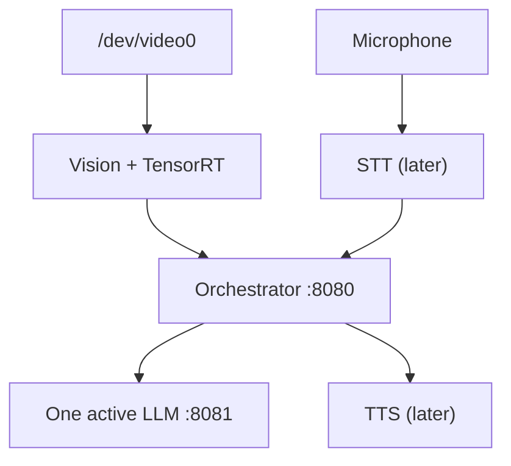

# Architecture

The bootc image owns the OS, Podman, Quadlet definitions and persistent-data initialization. Application images are built, versioned and updated separately.

The VLM is intentionally postponed until the text LLM, detector and audio baseline has measured peak memory. It receives a selected frame only, never the continuous stream.

All model weights, generated engines and state live under `/var/lib/multimodal-assistant`. The engine cache manifest contains the model SHA-256, TensorRT/CUDA identification, architecture/kernel and engine options; a mismatch produces a new engine path.
